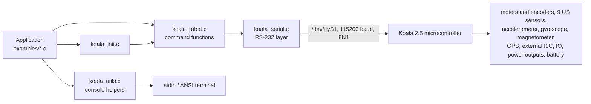

# Koala 2.5 library (libkoala) - documentation hub

This repository holds `libkoala`, a C library that controls the K-Team Koala 2.5
mobile robot by sending ASCII commands to the robot's microcontroller over a serial
line, plus three example programs that use it. The library source is K-Team code
(copyright K-Team S.A. 2013, LGPL 2.1 or later, per the header of every `.c` and `.h`
file in `src/`); the repository owner's own changes are a refactoring of one example, Makefile
edits, the top-level README and housekeeping commits (see Status). Who the intended
users of this copy are is not stated in the repository (see [SPEC.md](../SPEC.md),
section 9).

The requirements specification reverse-engineered from the code is [SPEC.md](../SPEC.md).

## Status

- Last commit: `dc18adb`, 2026-08-08 ("chore: untrack compiler output"). It removed
  `src/*.o` and touched `.gitignore` only.
- Last change to C sources: `fc06d99`, 2023-02-14 (`examples/koala_auto_mode_test.c`).
  The library sources `src/*.c` have not changed since the upload in `98dbb69`,
  2023-02-10. Last Makefile change: `10b1006`, 2023-07-18 (`git log`).
- Tests: no automated tests. `examples/koala_test.c` is an interactive program that
  exercises the library on the robot; it is not a test suite.
- CI: none (no workflow files in `git ls-files`).
- Unfinished:
  - `examples/koala_auto_mode_test.c` as committed cannot be compiled (see Known
    limitations); its prebuilt binary was deleted in `10b1006`.
  - `test_sound()` in `examples/koala_test.c:539-542` is an empty stub.
  - Most of `examples/koala_example.c` (battery, US, GPS, I2C, PID, accelerometer
    demos, lines 92-244) is commented out.
  - The "Example" block of `../README.md:51-64` is a placeholder (`// Code snippet here...`).

## Layout

| Path | Content |
|---|---|
| `src/koala.h` | Umbrella header; `KOALA_VERSION` 1, `KOALA_REVISION` 1 |
| `src/koala_init.c/.h` | `koala_init()` / `koala_exit()`: option parsing, open and close the robot link |
| `src/koala_serial.c/.h` | RS-232 layer: open, raw read/write, line read with timeout |
| `src/koala_robot.c/.h` | One function per serial protocol command; constants, unit factors, `koala_auto_data_t` |
| `src/koala_utils.c/.h` | Console helpers: `koala_kbhit`, terminal mode, ANSI cursor control, `koala_timeval_diff` |
| `src/Makefile` | Builds `libkoala.so.1.0` and `libkoala.a` into `build-x86/`, installs into `/usr` |
| `src/Doxyfile`, `src/kteamdoxy.css` | Doxygen configuration (output to `../doc`, not committed) |
| `src/robot` | Text fragment of a different, I2C-register based API; not compiled (no `.c` suffix) |
| `build-x86/` | Committed build output: headers (identical to `src/*.h`), `libkoala.a`, `libkoala.so.1.0`, symlink `libkoala.so` |
| `examples/koala_test.c` | Interactive menu program covering every library command |
| `examples/koala_example.c` | Magnetometer calibration and compass heading control |
| `examples/koala_auto_mode_test.c` | Auto-monitoring printout, refactored by the owner; does not compile |
| `examples/Makefile` | Builds the three examples against `../build-x86` |
| `examples/koala_example`, `examples/koala_test` | Committed x86-64 Linux binaries |
| `Koala2.5 User Manual 1.3.pdf` | K-Team user manual, revision 1.3 |
| `Koala2.5 User Manual 1.3(EDIT).docx` | Word copy of the same manual, last modified by the owner (what was edited is not recorded) |

## Architecture

The application calls `koala_init()`, which opens the serial device. Each command
function in `koala_robot.c` formats one ASCII frame, writes it through
`koala_serial.c`, reads one reply line and checks its first character. In
auto-monitoring mode the microcontroller sends frames without being asked;
`koala_get_from_auto_mode()` reads them without waiting.



Sources: `src/koala_robot.h:45-46` (device, baud rate), `src/koala_serial.c:85`
(`CS8 | CLOCAL | CREAD`, no parity, one stop bit), `src/koala_robot.c` (commands).
Hardware facts not visible in code come from the manual: the library runs on the
robot's onboard Pico-ITX computer (Intel Atom N2800, 64-bit Ubuntu), and the
microcontroller is a dsPIC33FJ64GS608 that answers serial commands on `/dev/ttyS1`
(`Koala2.5 User Manual 1.3(EDIT).docx`, chapters "Pico-ITX", "Microcontroller",
"Programming").

## Build and run

Prerequisites (from the build files; no versions are pinned anywhere):

- Linux with `termio.h` and `getopt.h` (`src/koala_serial.h:37`, `src/koala_init.c:38`).
- A C compiler as `$(CC)`, `ar` as `$(AR)`, `libm` (`src/Makefile:17,43,45`).
- GNU `cp` with `-s` (symbolic link) for the `libkoala.so` link (`src/Makefile:50,65`).
- Optional: `doxygen` for `make docs` (`src/Makefile:31`; `src/Doxyfile` was written
  for Doxygen 1.6.3, `src/Doxyfile:1`), `makedepend` for `make depend` (`src/Makefile:71`).

Build and install the library (run in `src/`):

```sh
make              # all -> libkoala.so.1.0, libkoala.a, headers in ../build-x86 (src/Makefile:24,33-50)
make DEBUG=1      # -g instead of -O3 (src/Makefile:11-15)
sudo make install # copy to /usr/lib and /usr/include/koala (src/Makefile:56-65)
make docs         # doxygen, output in ../doc (src/Makefile:29-31, src/Doxyfile:41)
make clean        # remove *.o, *~, .depend, core* (src/Makefile:52-54)
```

Build the examples (run in `examples/`, after the library is built):

```sh
make              # koala_example koala_test koala_auto_mode_test (examples/Makefile:27,39)
make clean        # examples/Makefile:64-66
```

As committed, `make` in `examples/` stops at `koala_auto_mode_test` (see Known
limitations). Running an example needs the robot's serial device and a way for the
loader to find `libkoala.so`; the repository's route is `sudo make install`
(commit `10b1006`, "sudo make install - add lib to path enviroment").

Run (on the robot, from `examples/`): `./koala_test`, `./koala_example`.

## Configuration

There are no environment variables and no configuration files (`getenv` and `fopen`
do not occur in `src/` or `examples/`). Everything is set at compile time or on the
command line.

| Name | Where | Meaning | Default |
|---|---|---|---|
| `-v`, `--version` | `src/koala_init.c:48-54,89-91` | Print `libkoala v1.1 [build date]` during `koala_init()` | off |
| `-d`, `--debug` | `src/koala_init.c:48-54,85-86` | Accepted, no effect; the short form is declared as taking an argument (`"d:v"`) | off |
| `KOALA_SERIAL_PORT_NAME` | `src/koala_robot.h:45` | Serial device of the microcontroller | `/dev/ttyS1` |
| `KOALA_SERIAL_PORT_BAUDRATE` | `src/koala_robot.h:46` | Baud rate | `B115200` |
| `KOALA_MOTOR_P/I/D` | `src/koala_robot.h:147-149` | Default PID used by the examples | 10, 3, 1 |
| `KOALA_MOTOR_ACC_INC` ... `KOALA_MOTOR_MAX_CURRENT` | `src/koala_robot.h:150-155` | Default speed profile used by the examples | 5, 1, 10, 200, 10, 10 |
| `DEBUG` | `src/Makefile:11`, `examples/Makefile:13` | `1` builds with `-g -fPIC`, otherwise `-O3 -fPIC` | unset |
| `TARGET_SYSTEM`, `BUILD` | `src/Makefile:5-6` | Output directory `../build-${TARGET_SYSTEM}` | `x86` |
| `INSTALL_PATH` | `src/Makefile:7` | Prefix for `make install` | `/usr` |
| `LIBNAME`, `LIBVER` | `src/Makefile:8-9` | Library file name and version suffix | `libkoala`, `1.0` |
| `BUILD`, `LIBS`, `INCS` | `examples/Makefile:11,20,23` | Library and include paths for the examples | `build-x86`, `-L../build-x86/lib -lkoala -lm`, `-I../build-x86/include` |

## Usage

Library call sequence (initialisation and set-up from `../README.md:16-43` and
`examples/koala_test.c:589-654`; the motor and sensor calls are illustrations):

```c
#include <koala/koala.h>

if (koala_init(argc, argv) < 0) { /* serial port could not be opened */ }
koala_get_firmware_version_revision(&version, &revision); /* examples retry once */
koala_configure_pid(KOALA_MOTOR_P, KOALA_MOTOR_I, KOALA_MOTOR_D);
koala_set_motor_speed_accel(100, 100);   /* pulses per 10 ms */
koala_read_us_sensors(us);               /* int us[KOALA_US_SENSORS_NUMBER] */
koala_set_motor_speed(0, 0);
```

`koala_test` reads one line per command; the first letters select the function and
the rest are its arguments (`examples/koala_test.c:664-692` prints the menu). Examples
of input lines, with the formats taken from the `sscanf` calls in that file:

| Input | Effect | Source |
|---|---|---|
| `ms 100 100` | Closed-loop speed, left and right | `examples/koala_test.c:1285-1293` |
| `msp 100 -100` | Speed with acceleration ramp | `examples/koala_test.c:1244-1252` |
| `mp 5000 5000` | Target position in pulses | `examples/koala_test.c:1306-1314` |
| `s` or a space | Stop motors | `examples/koala_test.c:1403-1410,1457-1462` |
| `pi 10 3 1` | Set PID | `examples/koala_test.c:1323-1327` |
| `am 6` | Auto-monitoring with speed and position, printed until a key is pressed | `examples/koala_test.c:923-1051` |
| `ir 118 0 10` | Read 10 bytes from I2C address 118, register 0 | `examples/koala_test.c:1150-1172` |
| `is` | Scan the external I2C bus | `examples/koala_test.c:1213-1224` |
| `u` | Ultrasonic distances with bar display | `examples/koala_test.c:1413-1455` |
| `d` | Keyboard drive mode (arrows or numpad, PgUp/PgDn +-1, Home/End +-25, `q` back) | `examples/koala_test.c:152-376` |
| `br` | Braitenberg obstacle avoidance until a key is pressed | `examples/koala_test.c:394-529` |
| `q` | Quit; Ctrl-C also stops the motors and restores the terminal | `examples/koala_test.c:52-59,1360-1362` |

`koala_example` rotates the robot in place for 2.5 turns to record magnetometer
extremes, then shows the heading and accepts `q`, left/right arrows, `s`/space,
`n` (turn to north) and `a` (enter a target angle 0-360) (`examples/koala_example.c:250-509`).

## Testing

No automated tests exist and nothing runs without the robot: every command function
goes to the serial device. The manual check is `examples/koala_test`, which reaches
every command function in `src/koala_robot.c` through its menu (FR list in
[SPEC.md](../SPEC.md) section 3 names the menu option per function). There is no
mock serial device.

## Known limitations

- `examples/koala_auto_mode_test.c` does not compile: the macro on line 13 declares a
  default argument (`error_return = -1`), which C does not allow (checked: the
  preprocessor reports "expected comma in macro parameter list"); `version` and
  `revision` used on lines 173-179 are not declared (by reading; the declaration
  `char revision, version;` was removed in `fc06d99`; the macro was added in
  `8258133`). The same file also passes an `int` to `%6.1f` (lines 47-53, 85-89),
  labels position as "Motor current" (line 123) and comments "wait 10 seconds" over `usleep(10000)`, which is 10 ms (lines 228-229).
- `process_param()` returns success when a reply has fewer values than requested; the
  rest of the caller's array is left unchanged (`src/koala_robot.c:61-80`).
- `koala_get_firmware_version_revision()` does a single raw `read()` of 7 bytes and
  fails if fewer arrive (`src/koala_robot.c:267-279`); the examples call it twice for
  this reason ("retry, because of the serial start level", `examples/koala_example.c:76-86`).
- The serial port is put in blocking mode (`src/koala_serial.c:80`) and only the first
  byte of a reply is guarded by the 500 ms timeout (`src/koala_serial.c:225-230`).
  Inference: a reply that stops before CR/LF blocks the caller.
- One global descriptor `koala_rs232` serves the whole process (`src/koala_robot.c:45`)
  and replies are tokenised with `strtok`. Inference: the library is not safe to call
  from several threads.
- `koala_getcommand_line_nowait()` is defined and exported but not declared in
  `src/koala_robot.h:216-218`; `examples/koala_test.c:1382` calls it undeclared.
- `src/koala_serial.c` calls `read`, `write`, `close` and `src/koala_robot.c:283` calls
  `atoi` without including `<unistd.h>` / `<stdlib.h>`; the examples call `usleep` and
  `sleep` without `<unistd.h>`. Inference: compilers that treat implicit function
  declarations as errors (GCC 14 and later by default) reject these files. Not built here.
- `malloc` in `koala_rs232_open()` is not checked (`src/koala_serial.c:78`).
- The drive mode's auto-stop when no key is pressed is commented out
  (`examples/koala_test.c:354-366`); the robot keeps the last speed until a stop key.
- Units in code comments differ from the manual: open-loop PWM range +-2000
  (`src/koala_robot.c:602`) against +-2940 in the manual ("L" command); `max_current`
  in mA (`src/koala_robot.c:548`) against 0.1 A, default 10 = 1 A in the manual
  ("J" command); AD range 0-1024 (`src/koala_robot.c:902`) against 0-1023.
- The manual describes `template/` and `doc/` directories, a top-level
  `make examples` and installation in `/usr/local/lib`; this repository has no
  top-level Makefile, no `template/`, no `doc/`, and installs into `/usr`
  (`src/Makefile:7`).
- Build output is committed although `.gitignore:15,26` lists `*.so` and `*.a`.
  `build-x86/lib/libkoala.so` is a git symbolic link (mode 120000); on a checkout
  without symlink support it is a 15-byte text file.
- `examples/.goutputstream-JN8QBX` is an empty tracked file.
- There is no LICENSE file (an MIT licence was added in `0ccfd2a` and removed in
  `d6fa511`); the sources state LGPL 2.1 or later. The refactored
  `examples/koala_auto_mode_test.c` no longer carries the K-Team header.

## Related documents

- [../README.md](../README.md) - project introduction and usage snippet
- [../SPEC.md](../SPEC.md) - software requirements specification
- [Koala2.5 User Manual 1.3.pdf](../Koala2.5%20User%20Manual%201.3.pdf) - K-Team manual, including the serial protocol chapter
- [Koala2.5 User Manual 1.3(EDIT).docx](../Koala2.5%20User%20Manual%201.3%28EDIT%29.docx) - Word copy of the manual
- [../src/Doxyfile](../src/Doxyfile) - API documentation generator settings

## About this document

Written 2026-11-18 from commit `dc18adb` (branch `docs/spec-and-docs`).

Commands run to check it: `git ls-files`, `git log` (with `--stat`, per path),
`git show`, `git diff 0c142f6 HEAD -- examples/koala_auto_mode_test.c`,
`git ls-files -s`, `file` on the binaries, `diff -q --strip-trailing-cr` between
`src/*.h` and `build-x86/include/koala/*.h` (identical), `llvm-nm -D --defined-only
build-x86/lib/libkoala.so.1.0` (every `koala_*` function defined in `src/*.c` is
exported; the implementations were not compared), `clang -E` on the macro line of
`koala_auto_mode_test.c` fed from stdin, and text extraction of the `.docx` manual
with Python's `zipfile`.

Not run: `make` in `src/` or `examples/` (this machine is Windows without Linux
headers such as `termio.h`), the example programs (they need the robot), `doxygen`.
The PDF manual was not read (no PDF renderer on this machine); manual facts above come
from the `.docx` copy.
